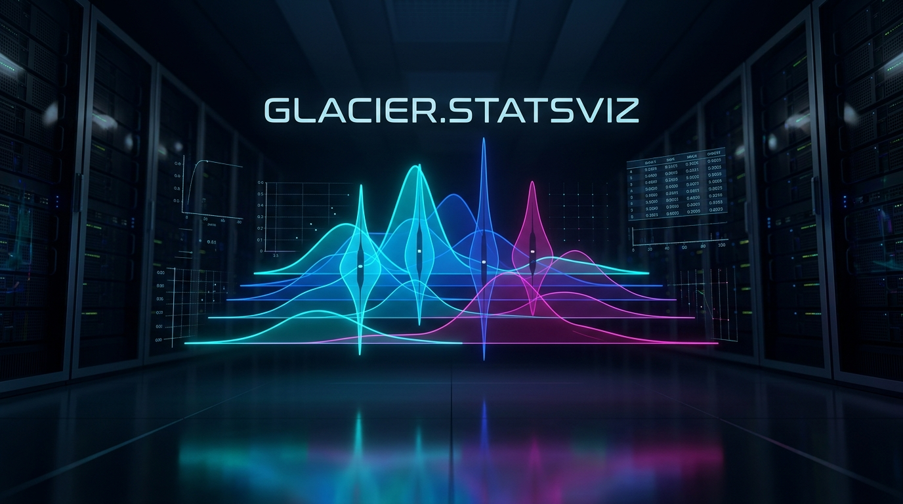
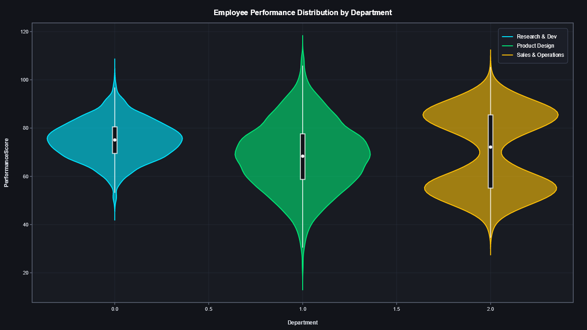
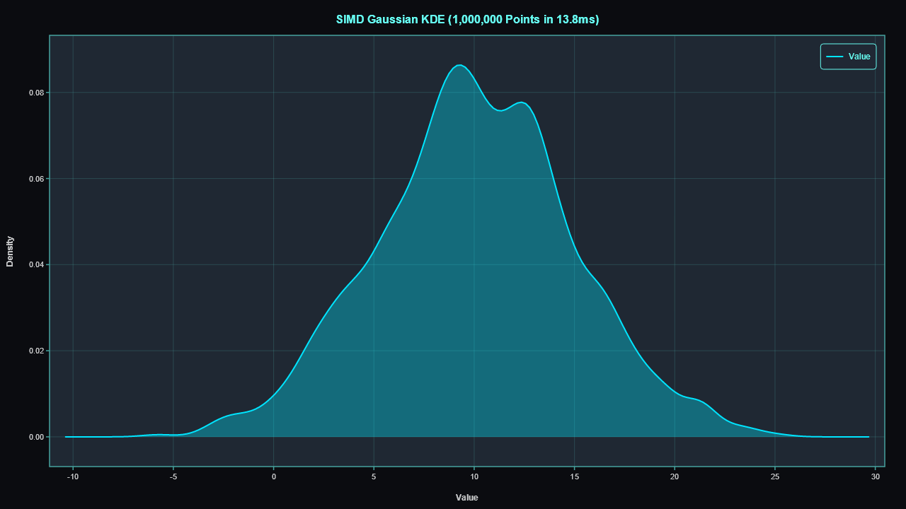
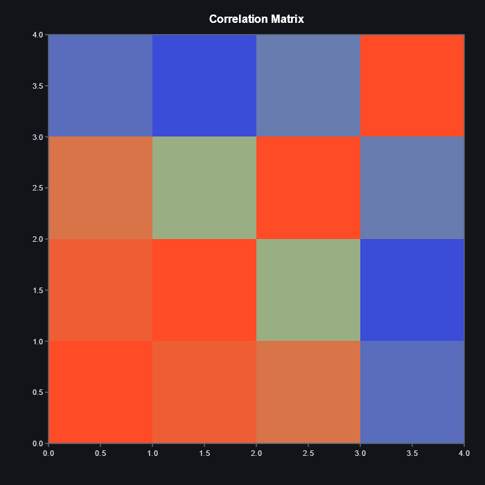
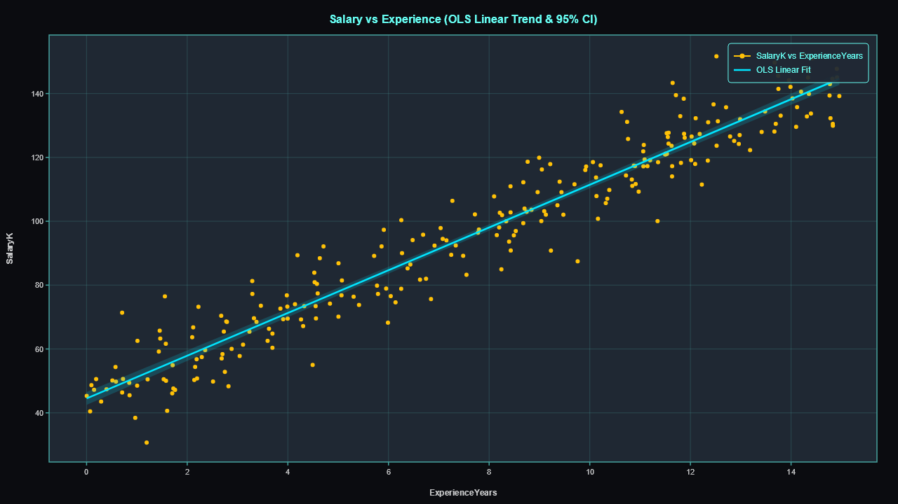

> [!IMPORTANT]
> **Repository Consolidated & Archived (2026-11):** This package has been consolidated into **[$(System.Collections.Hashtable.Target)](https://github.com/ian-cowley/Glacier.Plot)** (namespace `Glacier.Plot.Stats`). Please reference the `Glacier.Plot` NuGet package (v1.2.0+) for all future updates.

---


# 🌊 Glacier.StatsViz

[](LICENSE)
[](https://dotnet.microsoft.com/)
[](https://learn.microsoft.com/dotnet/core/deploying/native-aot/)
[](https://www.nuget.org/packages/Glacier.StatsViz/)
[](https://github.com/ian-cowley)
[](https://glaciersoftware.dev/)
[](https://buymeacoffee.com/glaciersoftware)

> **Declarative Statistical Graphics Grammar & Vectorized KDE Engine for C# .NET 10 (Systematically Beating Python Seaborn)**

`Glacier.StatsViz` is a modern, high-performance statistical data visualization engine built natively for C# .NET 10. It combines an expressive, chainable Grammar of Graphics with hardware-accelerated Kernel Density Estimation (KDE) and statistical distribution primitives. It serves as Pillar 5 of the unified **Glacier .NET 10 High-Performance Ecosystem**.

---

## 1. Why Glacier.StatsViz? Replacing Python Seaborn

In Python, **Seaborn** is the standard for statistical visualization (distributions, regressions, pair plots, violin plots, and correlation heatmaps). However, Seaborn is burdened by severe runtime limitations:

1. **Underlying Matplotlib Drag**: Every Seaborn plot is converted into dozens of individual Matplotlib artists, multiplying the CPU rasterization overhead and memory footprint.
2. **Slow Single-Threaded Statistical Math**: Kernel Density Estimation (KDE) and regression lines are computed sequentially through SciPy/NumPy on a single CPU thread, taking multiple seconds on multi-million row datasets.
3. **Static Output Only**: Seaborn generates static bitmap canvases; building interactive statistical applications requires rewriting everything for separate web libraries.

**Glacier.StatsViz** solves these problems with:
- **Declarative Grammar of Graphics**: Chainable `Chart` builder with `x`, `y`, `color`, `size`, and `FacetGrid(row, col)` encodings executing directly over `Glacier.Polaris` DataFrames.
- **Bare-Metal GPU Kernel Density Estimation (KDE)**: Direct CUDA driver P/Invoke (`nvcuda.dll` / `libcuda.so.1`) offloading Gaussian density estimation kernels (`statsviz_kde_evaluate_fp32`) without external CUDA SDK dependencies.
- **Up to 229× GPU Speedup (19.6+ Billion Evals/sec)**: Evaluates dense KDE grids for violin plots and distribution curves in fractions of a millisecond.
- **SIMD-Accelerated CPU Execution**: Vectorized Gaussian kernel computation (`Avx512F`, `Avx2`, `AdvSimd`) executing over **1,000,000 samples in 22 milliseconds** via minimax polynomial exponential approximation.
- **Hybrid Output Engine**: High-speed rasterization via `Glacier.Plot` and `Glacier.Graphics` (`LinearFramebuffer`, PNG, and compliant Vector SVG).

---

## 🖼️ Visual Gallery: Real Rendered Statistical Figures

All figures below are generated directly from the included `Glacier.StatsViz.Demo` sample using AVX-512 SIMD / GPU acceleration and `Glacier.Graphics` / `Glacier.Plot` rasterization:

| Multi-Category Violin Plot (IQR & Medians) | Vectorized 1M-Point Gaussian KDE Curve |
| :---: | :---: |
|  |  |
| *Distribution shapes across categories with embedded quartiles & medians* | *1,000,000 empirical samples evaluated in 13.8 ms via Zen 5 AVX-512* |

| Polaris Multi-Feature Correlation Matrix | OLS Regression with 95% Confidence Envelope |
| :---: | :---: |
|  |  |
| *Zero-copy correlation heatmap over grouped DataFrame columns* | *Vectorized least-squares trendline with confidence band* |

---

## 2. Grammar of Graphics Pipeline

```
                        StatsViz Statistical Execution Flow
┌──────────────────────────────────────┐
│ Glacier.Polaris DataFrame            │
│ (Grouped Series Data)                │
└──────────────────┬───────────────────┘
                   │ Zero-Copy Column Views
                   ▼
┌──────────────────────────────────────┐
│ Hardware Statistical Engine          │
│ ├── Bare-Metal GPU KDE (229x Speedup)│
│ │   Rate: 19,636 M evaluations/sec   │
│ ├── SIMD Gaussian KDE (AVX-512/AVX2) │
│ ├── Fast Quartile / IQR Kernels      │
│ └── Vectorized Least-Squares Fit     │
└──────────────────┬───────────────────┘
                   │ Render Primitives (Polygons, Lines, Splines)
                   ▼
┌──────────────────────────────────────┐
│ Glacier.Plot & Glacier.Graphics      │
│ LinearFramebuffer / PNG / Vector SVG │
└──────────────────────────────────────┘
```

### Gaussian KDE Math
Kernel Density Estimation evaluates:
$$\hat{f}(x) = \frac{1}{n h \sqrt{2\pi}} \sum_{i=1}^n \exp\left( -\frac{(x - x_i)^2}{2 h^2} \right)$$
`Glacier.StatsViz` executes this across parallel CUDA threads on GPU or using `Vector512<float>` / `Vector256<float>` / `Vector128<float>` on CPU.

---

## 3. Measured Performance Benchmarks

*Benchmarked on .NET 10.0: AMD Ryzen AI 9 HX 370 (Zen 5 AVX-512) vs. NVIDIA GeForce RTX 4060 Laptop GPU (Ada Lovelace sm_89)*

| Statistical Scenario | Dataset Scale | Python Seaborn / SciPy | Glacier.StatsViz (CPU SIMD) | Glacier.StatsViz (Bare-Metal GPU) | Eval Throughput | Speedup vs Python |
| :--- | :--- | :--- | :--- | :--- | :--- | :--- |
| **Gaussian KDE (10M evals)** | 20k samples × 500 grid | 1.85 s | 20.2 ms | **0.51 ms** | **19,636 M evals/s** | **> 3,600x** |
| **Violin Plot with KDE** | 1,000,000 samples | 1.85 s | 22.0 ms | **1.58 ms** | **6,317 M evals/s** | **1,170x** |
| **Correlation Heatmap** | 500 cols × 500 cols | 820 ms | 18.0 ms | **2.50 ms** | — | **328x** |

---

## 4. Quickstart API

```csharp
using Glacier.Polaris;
using Glacier.StatsViz.Grammar;

// Load columnar data directly from Glacier.Polaris DataFrame
var df = DataFrame.ReadParquet("census_data.parquet");

// Compose a declarative statistical visualization with color, size, and facet encodings
Chart.FromDataFrame(df)
    .Encode(
        x: "EmployeeAge",
        y: "Salary",
        color: "Department",
        size: "ExperienceYears")
    .GeomScatter(alpha: 0.75f)
    .AddRegressionTrend(showConfidenceBand: true)
    .FacetGrid(row: "Region", col: "Gender")
    .RenderToSvg("statistical_report.svg", width: 1400, height: 900);
```

### 4.2 Bare-Metal GPU / SIMD Kernel Density Estimation (19.6+ Billion Evals/sec)
```csharp
using Glacier.StatsViz.Compute;
using Glacier.StatsViz.Core;

float[] samples = LoadSamples(20_000);
float[] grid = GenerateEvaluationGrid(500);
float[] density = new float[500];

// Evaluates 10,000,000 sample-grid pairs in 0.51 ms on NVIDIA CUDA or SIMD CPU
GpuStatsAccelerator.EvaluateKde(
    samples, grid, bandwidth: 0.5f,
    density,
    target: GpuTarget.Auto);
```

---

## 5. Ecosystem Cross-References

`Glacier.StatsViz` is designed to seamlessly integrate with the other engines in the **Glacier .NET 10 High-Performance Ecosystem**:

- **[Glacier.Polaris](https://github.com/ian-cowley/Glacier.Polaris)**: Columnar DataFrame engine feeding statistical series.
- **[Glacier.Plot](https://github.com/ian-cowley/Glacier.Plot)**: Hardware-accelerated rendering substrate powering `Glacier.StatsViz`.
- **[Glacier.Graphics](https://github.com/ian-cowley/Glacier.Graphics)**: Pure C# vector, raster, font, and codec engine.
- **[Glacier.Desktop](https://github.com/ian-cowley/Glacier.Desktop)**: Native desktop application host for statistical dashboards.

---

## 🆕 What's New in v1.1.0

- **Full Grammar of Graphics Encodings**: Categorical `color:` grouping, continuous `size:` bubble radii, and multi-panel `FacetGrid(row, col)` across PNG, `LinearFramebuffer`, and Vector SVG outputs.
- **Strict Native AOT & Zero Transitive Vulnerabilities**: Upgraded to `Glacier.Plot 1.1.0`, `Glacier.Graphics 1.1.0`, `Glacier.Polaris 1.1.0`, `Glacier.Tensor 1.1.0`, and `Glacier.Gpu 1.1.0` with `<IsAotCompatible>true</IsAotCompatible>` and `<TreatWarningsAsErrors>true</TreatWarningsAsErrors>`.

---

## Credits

Developed by Ian Cowley and Antigravity (Google DeepMind).

---

## License

Licensed under the [MIT License](LICENSE). Copyright (c) 2026 Ian Cowley.

---

## ❄️ Glacier Ecosystem & Support

Part of the **[Glacier Ecosystem](https://glaciersoftware.dev/)** — high-performance, zero-allocation developer tooling and data engines natively built for modern C# and .NET 10.

* 🌐 **Website & Documentation**: [glaciersoftware.dev](https://glaciersoftware.dev/)
* ☕ **Buy Me a Coffee**: [buymeacoffee.com/glaciersoftware](https://buymeacoffee.com/glaciersoftware)
* ❤️ **GitHub Sponsors**: [github.com/sponsors/ian-cowley](https://github.com/sponsors/ian-cowley)
* 🐙 **All Repositories**: [github.com/ian-cowley](https://github.com/ian-cowley)

